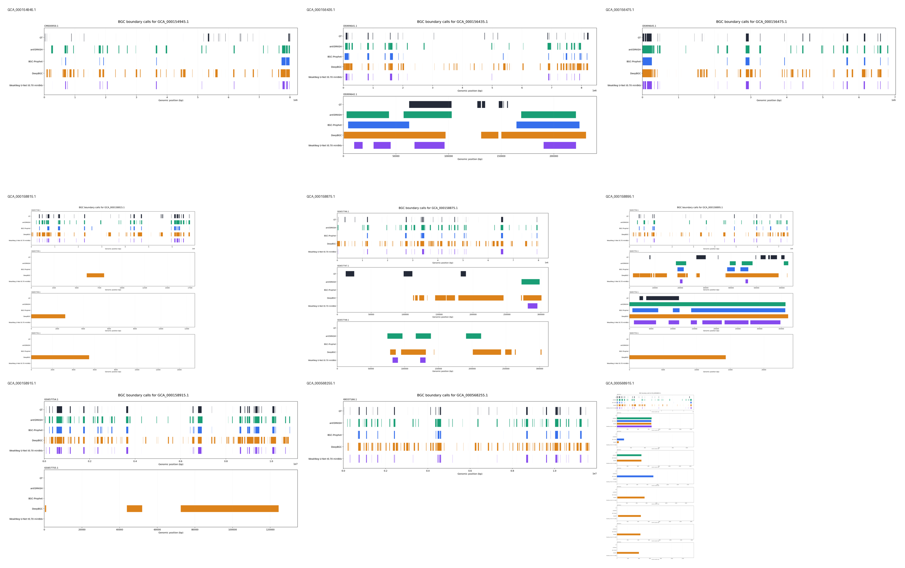

# NP-Master

NP-Master is a BGC region detection and discovery pipeline for bacterial genomes and metagenomes. It is not a generative model: given DNA sequences, it predicts genomic intervals that look like biosynthetic gene clusters, then optionally adds BGC type labels and novelty triage metadata.

## System I/O

Input: one or more DNA contigs/genomes, usually FASTA. The server-side pipeline extracts frozen Evo2 7B `blocks.20.mlp.l3` features.

Output: BGC region calls with `genome`, `contig`, `start`, `end`, score/source fields, and optional type/novelty annotations.

## Active Mainlines

| Mainline | Purpose | Status | Key entrypoints | Results |
|---|---|---|---|---|
| `evo2_lr_multiscale` | Original v4.1 line renamed: Evo2 mean-pool embeddings + LR scorer + multi-scale decoder. | Formal 9-genome mainline. OER learned-decoder variant is metagenome-focused. | `scripts/decode/evo2_lr_multiscale.py`, `scripts/evaluate/evo2_lr_multiscale.py`, `scripts/decode/evo2_lr_learned_decoder.py` | `experiments/evo2_lr_multiscale/` |
| `evo2_per_token_unet` | Per-token Evo2 features + U-Net decoder for short metagenomic contigs. | Exploratory discovery candidate. Current wet-lab handoff uses the weak-negative BCE model; 9-genome numbers remain diagnostic, not formal claims. | `scripts/train/evo2_per_token_unet/`, `scripts/inference/evo2_per_token/`, `scripts/decode/evo2_per_token_regions.py` | `experiments/evo2_per_token_unet/` |

`defrag_v2` detection and other probes are retired from active development. Historical files were moved to `_archive/2026-04-26-mainline-reset/` and are intentionally ignored by git.

## Canonical Numbers

See `docs/REGRESSION_LEDGER.md` for the current claims and caveats. Headline active numbers:

- `evo2_lr_multiscale` on 9-genome: dedup F1 `0.4878`, bench precision `0.5976`, bench recall `0.4590`.
- `evo2_lr_learned_decoder` on OER004256: 1,230 regions, 429 antiSMASH-missed candidates in the committed handoff artifact.
- `evo2_per_token_unet` weak-negative BCE on OER004256: AS-recall `0.5703` at `thr0.50/min2kb`, 579 antiSMASH-missed candidates, 171 first-pass wet-lab PASS after HMM/MIBiG triage.
- `evo2_per_token_unet` weak-negative BCE on 9-genome: diagnostic dedup F1 `0.5094` at `thr0.70/min8kb`; not a formal benchmark claim.

## Qualitative Boundaries

The current weak-negative U-Net 9-genome diagnostic point (`threshold=0.70`, `min_len=8kb`) has per-genome boundary plots in `figures/evo2_per_token_unet_boundaries_weakneg_thr070_min8000/`.



## Layout

- `configs/`: active YAML configs only.
- `src/`: importable library code for active mainlines.
- `scripts/`: CLI entrypoints grouped by verb.
- `experiments/`: promoted active outputs only.
- `docs/`: current conventions, evaluation protocol, and regression ledger.
- `_archive/`: retired local provenance; not tracked.

## Quick Commands

```bash
python scripts/evaluate/evo2_lr_multiscale.py \
  --primary-preds <server-primary-preds-dir> \
  --short-preds <server-short-preds-dir> \
  --gt-json /data/syh/benchmark/nine_genome/ground_truth.json \
  --out-json experiments/evo2_lr_multiscale/nine_genome_readout.json
```

```bash
python scripts/decode/evo2_per_token_regions.py \
  --probs-dir <per-token-probs-dir> \
  --out-regions-csv <regions.csv> \
  --threshold 0.3
```
