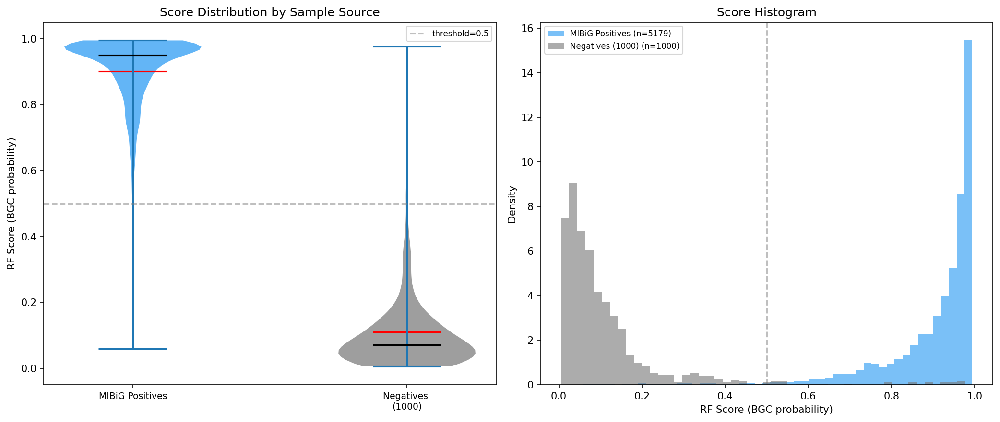

# 来源偏差诊断实验

## 目的

**正样本来自MIBiG**（孤立BGC序列，人工整理），**负样本来自NCBI参考基因组**（连续序列）。如果 Evo2 能区分"MIBiG整理的DNA"和"基因组连续DNA"，那高 AUROC 可能是**来源差异的artifact**而非真正的BGC特征。

这是本项目最关键的"可信度诊断"。

## 实验设计

用已训练的 RF 对所有样本打分，对比**三组**得分分布：

1. **MIBiG正样本**（train+test合并，5179 windows）
2. **负样本**（随机采样1000 windows）
3. **基因组原位BGC**：从105个Strep基因组的 antiSMASH 标注BGC区域**直接切窗口**（18882 windows, w16384, coverage>50%）

**第三组是关键**：同样是BGC，但来自基因组连续序列而非MIBiG孤立片段。

### 判断标准

| 原位BGC得分位置 | 结论 |
|---|---|
| 接近MIBiG（均值差<0.05, p>0.05） | ✓ 来源偏差不严重，现有结果可信 |
| 介于MIBiG和负样本之间 | △ 存在偏差，需在论文中讨论 |
| 接近负样本 | ✗ 模型主要学了来源差异，结果不可信 |

## Phase 1 结果（MIBiG vs 负样本，已完成）

| 组别 | N | Mean | Median | Q25 | Q75 | Std |
|---|---|---|---|---|---|---|
| MIBiG Positives | 5179 | **0.901** | 0.950 | 0.869 | 0.982 | 0.124 |
| Negatives (1000) | 1000 | **0.109** | 0.071 | 0.036 | 0.131 | 0.134 |

- MIBiG正样本漏检率（得分<0.5）：**1.8%** (91/5179)
- 负样本误报率（得分>0.5）：**2.6%** (26/1000)
- 两组分布**完全分开**，几乎无重叠

## Phase 1 结论

**仍无法下结论**：两组分开只证明模型能区分它们，但**无法鉴别**是学到了BGC特征还是来源差异。两种解释都能产生这样的分布。

**等GPU空闲后跑 Phase 2**（加入原位BGC）才能真正判断。

## Phase 2 准备（进行中）

### 已完成
- 扫描105个Strep基因组的antiSMASH结果
- 从3465个BGC region切出 **18882 个 in-situ BGC窗口**（w=16384, coverage>50%）
- 独立基因组：105
- GC含量：0.702 ± 0.023（与MIBiG Strep BGC一致）
- 保存：`data/expanded_strep/insitu_bgc/insitu_bgc_w16384.pkl` (311 MB)

### 待办
- [ ] 上传pkl到GPU服务器
- [ ] 提取 Evo2 embedding（w16384, 18882样本，预计~8小时）
- [ ] 跑 `python3 -u 21_source_bias_diagnosis.py --with-insitu`

## 潜在复杂因素

### 窗口大小不一致
- MIBiG正样本用的 w8192（训练数据）
- in-situ BGC切的 w16384（本实验）
- **解决**：可以用w8192 in-situ BGC来严格对比，或用w16384训练RF再评估

### coverage 阈值
- 当前阈值 50%（BGC覆盖窗口的一半以上）
- 太低：窗口大部分是非BGC
- 太高：只有BGC中心
- 可做消融：30% / 50% / 70%

## 代码

- `scripts/21_source_bias_diagnosis.py`

## 对项目主线的重要性

**如果Phase 2显示 in-situ BGC ≈ 负样本 得分**，那么：
- 当前所有实验的结论都要重新评估
- 需要重新设计正样本构造（从基因组原位提取，而非MIBiG）
- 是研究项目的重大转折点

**如果显示 in-situ BGC ≈ MIBiG 得分**，那么：
- 说明模型真的在识别BGC，不是在识别来源
- 现有结果全部可信
- 项目可以安心推进后续实验

## 日期

- 2026-04-05: Phase 1 完成
- 待定: Phase 2（依赖GPU）
